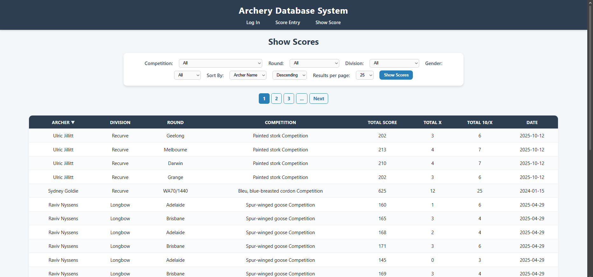

# 🎯 Archery Database System

A relational database web application developed as part of the **COS20031 Database Design** course project. The system was designed from the ground up to streamline score recording, management, and historical data filtering for an archery club organization.

---

## 📌 Features & Responsibilities

### 🏹 Show Scores Module (*My Contribution*)
I was responsible for designing and developing the **Show Scores** (`showscore.php`) interface, which provides comprehensive dynamic filtering, sorting, and pagination for club records:

* **Dynamic Multi-Criteria Filtering:** Filter records by Competition, Round, Division, and Gender.
* **Server-Side Sorting & Pagination:** Interactive table headers allowing users to sort by Archer Name, Total Score, or Date in ascending or descending order, with customizable page limits (10, 25, 50 results).
* **Relational Query Optimization:** Executes complex SQL join operations connecting `Scores`, `Archers`, `Categories`, `Division`, `Rounds`, and `Competitions` tables.

---

## 📸 Interface Preview

---

## 🛠️ Tech Stack & Database Architecture

* **Backend:** PHP 8.x
* **Database:** MariaDB / MySQL
* **Frontend:** HTML5, CSS3
* **Database Architecture:** Normalized relational schema covering competition events, division categories, archer profiles, and scoring records.

---

## ⚠️ Hosting Note

Because this project relies on **server-side PHP execution** and **live MariaDB database connections**, it cannot be hosted statically on GitHub Pages. Demonstration of full dynamic functionality requires a web server environment running Apache/Nginx with PHP and MySQL/MariaDB support.
